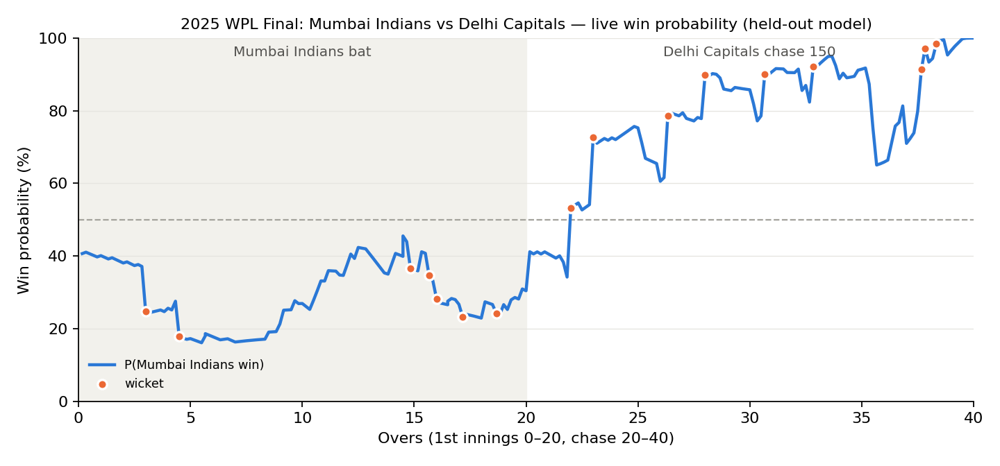
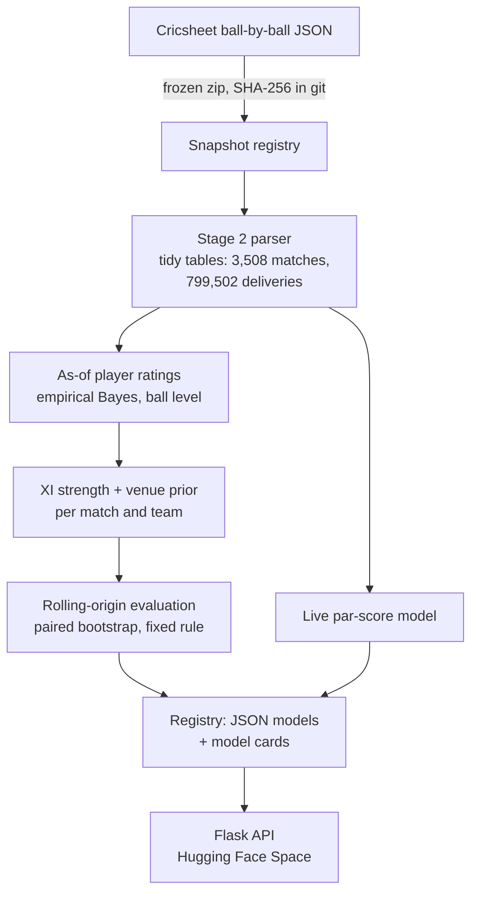

# 🏏 WPL Decision Engine

[](https://github.com/Riks1/WPL-Final/actions/workflows/ci.yml)


[](LICENSE)

> **Win probability for the Women's Premier League, built so that every number can be checked.**

Who's going to win this match, and how sure should we be? This project answers that for women's T20 franchise
cricket, both **before the first ball** and **ball by ball** as the game unfolds, and serves the answers through a
tested Flask API.




*The 2025 WPL Final, ball by ball. This curve comes from the par-score model with the whole 2025 season held out,
so it had never seen this match. Mumbai Indians' 149 looked below par, and Delhi Capitals began the chase as 59%
favourites. Then their early wickets turned the game. 

---

## The real challenge: not fooling yourself

The WPL plays just **22 matches a season**. With so little data, fitting a model is easy; trusting it is hard.
So this project holds itself to three rules:

1. **Every model is scored on seasons it never trained on.**
2. **Every interval comes from a bootstrap over matches**, so uncertainty is reported honestly.
3. **Every deployment decision follows a rule written down before the final run**, so the result can't be
   nudged after the fact.

Sometimes that means the answer is "this model isn't good enough yet", and this README says so.

---

## Results at a glance

All results are on **66 held-out WPL matches (2024–2026)**.

*How to read this:* log-loss measures how good the probabilities are (**lower is better**). The "base rate" is the
naive guess that ignores the match entirely. Δ is the paired difference against that baseline, with a 95%
bootstrap confidence interval over matches. A negative Δ means the model beats the baseline.

| Question | Model | Result | Decision |
|---|---|---|---|
| **Live** (ball by ball) | Par-score: DLS resource curve + negative binomial, 5 parameters | **0.528** vs base rate 0.703; Δ −0.175 [−0.286, −0.059] | ✅ **Deployed.** Logistic regression and random forest did not beat it |
| **Pre-match**, team form | Logistic: form, head-to-head, toss | Δ +0.066 [+0.001, +0.135] vs base rate | ❌ Not deployed |
| **Pre-match**, player ratings | Logistic: XI-strength margin + toss | Δ **+0.087 [+0.012, +0.162]** vs base rate | ❌ **Not deployed** (pre-specified rule) |
| — same features, India T20Is | (supporting analysis, 53 matches) | Δ −0.203 [−0.312, −0.079] | Never decides |

### What this means in plain words

- **The live model works.** A small, five-parameter model built on cricket logic clearly beats the baseline, and
  fancier models couldn't improve on it.
- **The pre-match models don't, yet.** Neither team form nor player ratings beat simply predicting the base rate.
- **But the player ratings aren't useless.** On India T20Is they cut log-loss by 0.20, and in the WPL the stronger
  XI still won 58% of test matches. The problem is the step that turns "stronger team" into a probability: it is
  fitted on only 22–66 matches, and one 22-match training fold even learned the wrong sign.

Fixing that is the next stage's job: pool training data across competitions, then run a prospective test on
WPL 2027. 
---

## How it works



Four ideas hold the whole thing together:

🔒 **Data you can verify.** Every Cricsheet download is frozen, hashed and registered in
[`data/snapshots/registry.json`](data/snapshots/registry.json). The loader refuses any file whose hash doesn't match.

⏳ **Ratings that can't see the future.** For a match on date *d*, a player's rating uses only deliveries before *d*.
The tests deliberately perturb future balls and check that no earlier rating moves
([`tests/test_ratings.py`](tests/test_ratings.py)). Full spec: [`docs/stage3/RATINGS_SPEC.md`](docs/stage3/RATINGS_SPEC.md).

📝 **Decisions fixed in advance.** Stage 3's question, models, metric and deployment rule were written down first:
[`docs/stage3/PREREG_stage3.md`](docs/stage3/PREREG_stage3.md). In the interest of honesty, the model card discloses
that the git tag meant to timestamp this document was misplaced.

🎯 **What's served is what was tested.** Models are plain JSON keyed to the data hash, and a parity test requires the
API to reproduce the training code's probabilities on 200 real match states.

---

## Where it started: auditing v0

The first version of this project looked great on paper: **73.8%** pre-match accuracy and a live log-loss of
**0.652**. Then I re-ran its own code ([`legacy/`](legacy/)) and found that:

- the "accuracy" was just the majority-class rate (it predicted the same outcome for every match);
- the live model never actually saw the target;
- cross-validation leaked every match into training;
- the deployed model received unscaled inputs.

Stage 1 rebuilt everything from that audit, and the lessons from it shaped every rule above.

---

## Roadmap

| Stage | Scope | Status |
|---|---|---|
| 1 | Audit of v0; live par-score model; parity-tested API; CI | ✅ [`v1`](https://github.com/Riks1/WPL-Final/tree/v1) |
| 2 | Women's T20 data layer: snapshots, parser, entities, validation | ✅ [`v2`](https://github.com/Riks1/WPL-Final/tree/v2) |
| 3 | As-of player ratings, XI strength, pre-specified pre-match evaluation, Postgres-ready API | ✅ [`v3`](https://github.com/Riks1/WPL-Final/tree/v3) |
| 4 | Pooled training across competitions; prospective test on WPL 2027 | 🔜 Planned |
| 5–10 | From prediction to decisions (team selection, match strategy) | 🔭 Planned |

---

## Run the API locally

> **Heads-up:** the API is not publicly hosted. Earlier versions of this README pointed to a Hugging Face Space,
> but that Space hasn't been fully deployed 

**With Docker:**

```bash
docker build -t wpl-api . && docker run -p 7860:7860 -e PREMATCH_VERSION=v3 wpl-api
python -m scripts.smoke_test --url http://localhost:7860 --expect-sha local      # 6 end-to-end checks
```

**Without Docker** (runs on port 5000):

```bash
pip install -r requirements.txt && PREMATCH_VERSION=v3 python run.py
```

Predictions are logged to SQLite by default, or to Postgres when `DATABASE_URL` is set. If the database goes down,
the API keeps serving.

### Endpoints

| Endpoint | Method | What it returns |
|---|---|---|
| `/api/live-predict` | POST | Win probability from the ball history of the current innings |
| `/api/prematch-predict` | POST | After the toss, before ball 1 (the base rate, and the response says why) |
| `/api/xi-strength` | POST | Two XIs (Cricsheet ids) rated in runs, with the margin and its uncertainty (not a win probability) |
| `/api/model-info` | GET | Model card: data hash, training date, library versions, deployment decision |
| `/api/history` | GET | Recent logged predictions |
| `/api/health` | GET | Model load status |

### Example: a live prediction

```bash
curl -X POST http://localhost:7860/api/live-predict -H 'Content-Type: application/json' \
  -d '{"innings": 2, "target": 166, "balls": [{"runs": 4, "legal": true, "wickets": 0}, {"runs": 1, "legal": false, "wickets": 0}]}'
```

Each ball needs three fields:

- `runs`: total off the delivery, including extras
- `legal`: `false` for wides and no-balls
- `wickets`: number of dismissals

You only send the raw balls; the server derives every feature using the same code as training.

---

## Reproduce everything

```bash
pip install -r requirements-dev.txt && pytest -q          # parsing, leakage, evaluation, API parity, Postgres

SNAP=all_female_json_20261025b.zip                        # fetched from Hugging Face and hash-checked
python -m scripts.build_stage2 --snapshot $SNAP --wpl-snapshot wpl_json_20261025.zip
python -m scripts.build_ratings --snapshot $SNAP
python -m scripts.build_xi --snapshot $SNAP
python -m scripts.evaluate_prematch --snapshot $SNAP
python -m scripts.write_prematch_card --snapshot $SNAP
```


## Repository map

| Path | Contents |
|---|---|
| [`notebooks/`](notebooks/) | **Start here:** `demo.ipynb`, plus the Stage 1 training notebook |
| [`wpl/`](wpl/) | Library: parser and entities (`data/`), live features, par-score, ratings, XI strength, evaluation harness |
| [`scripts/`](scripts/) | One command per build step (Stage 2 tables, ratings, XI features, evaluation, model card) |
| [`app/`](app/) | Flask API: routes, schemas, services, prediction log |
| [`models/`](models/) | Served models as JSON, model card, parity fixture |
| [`reports/`](reports/) | Every reported number, by stage |
| [`docs/`](docs/) | Pre-registration, ratings spec, model cards |
| [`paper/`](paper/) | Technical report (LaTeX source, tables generated from `reports/`) |
| [`tests/`](tests/) | Unit, leakage and parity tests |
| [`legacy/`](legacy/) | The v0 audit |

---

## Known limitations

Being upfront about what this can't do yet:

- **Small samples.** With 22 matches a season, evaluations can only detect log-loss gains of about 0.07 or more.
- **A reused test set.** The 2024–2026 WPL matches were the test set in both Stage 1 and Stage 3. The genuinely
  fresh test will be WPL 2027.
- **A context-blind live model.** It doesn't use team, player or venue information yet.
- **Gaps in the data.** Impact-player swaps are not modelled, and Indian domestic cricket is absent, so uncapped
  players start at a debutant prior.

## License

[MIT](LICENSE). Match data from [Cricsheet](https://cricsheet.org), under the Open Data Commons Attribution License.
