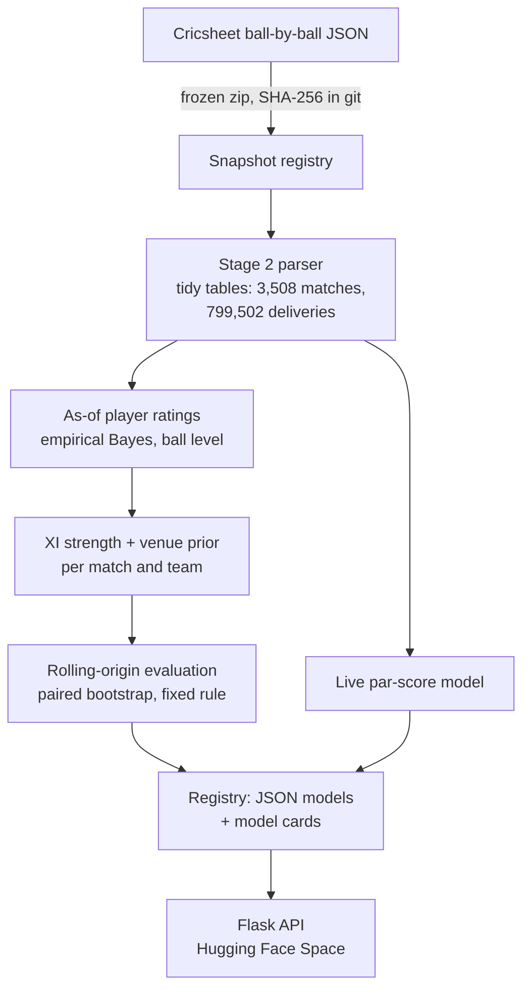

# WPL Decision Engine

**Win probability for the Women's Premier League, built so that every number can be checked.**

[](https://github.com/Riks1/WPL-Final/actions/workflows/ci.yml)


[](LICENSE)

Ball-by-ball and pre-match win probability for women's T20 franchise cricket, with a tested Flask API.
**[Demo notebook](notebooks/demo.ipynb)** (runs in your browser:
[](https://colab.research.google.com/github/Riks1/WPL-Final/blob/main/notebooks/demo.ipynb))
· **[Technical report (PDF)](paper/wpl_stage1-3_report.pdf)**
The WPL plays 22 matches a season, so the hard part is not fitting a model but not fooling yourself:
every model here is scored on held-out seasons, every interval comes from a bootstrap over matches,
and every deployment decision follows a rule written down before the final run.


*The 2025 WPL Final, ball by ball, from the par-score model with the 2025 season held out (it never saw this
match). Mumbai Indians' 149 looked below par, so Delhi Capitals started the chase as 59% favourites; their early
wickets turned it. Reproduced in the [demo notebook](notebooks/demo.ipynb).*

## Results at a glance

All on 66 held-out WPL matches (2024–2026). Log-loss per match; Δ is paired against the stated baseline,
95% bootstrap CI over matches. Lower is better.

| Question | Model | Result | Decision |
|---|---|---|---|
| Live (ball by ball) | Par-score: DLS resource curve + negative binomial, 5 parameters | **0.528** vs base rate 0.703; Δ −0.175 [−0.286, −0.059] | **Deployed.** Logistic and random forest did not beat it |
| Pre-match, team form | Logistic: form, head-to-head, toss | Δ +0.066 [+0.001, +0.135] vs base rate | Not deployed |
| Pre-match, player ratings | Logistic: XI-strength margin + toss | Δ **+0.087 [+0.012, +0.162]** vs base rate | **Not deployed** (pre-specified rule) |
| — same features, India T20Is | (supporting analysis, 53 matches) | Δ −0.203 [−0.312, −0.079] | Never decides |

The player ratings carry real signal: on India T20Is they cut log-loss by 0.20, and in the WPL the stronger
XI still won 58% of test matches. They fail in the WPL because the strength-to-probability mapping is fitted
on 22–66 matches; one 22-match training fold learned the wrong sign. That is the next stage's problem
(pooled training, then a prospective test on WPL 2027). Details: [model card](docs/stage3/MODEL_CARD_prematch_v3.md).

## How it works



- **Data you can verify.** Every Cricsheet download is frozen, hashed and registered in
  [`data/snapshots/registry.json`](data/snapshots/registry.json); the loader refuses a file whose hash does not match.
- **Ratings that cannot see the future.** For a match on date *d*, a player's rating uses only deliveries before *d*.
  Tests perturb future balls and check that no earlier rating moves ([`tests/test_ratings.py`](tests/test_ratings.py)).
  Spec: [`docs/stage3/RATINGS_SPEC.md`](docs/stage3/RATINGS_SPEC.md).
- **Decisions fixed in advance.** Stage 3's question, models, metric and deploy rule:
  [`docs/stage3/PREREG_stage3.md`](docs/stage3/PREREG_stage3.md). The model card discloses that the git tag meant to
  timestamp it was misplaced.
- **What is served is what was tested.** Models are plain JSON keyed to the data hash; a parity test requires the API
  to reproduce the training code's probabilities on 200 real match states.

## Where it started: auditing v0

The first version reported 73.8% pre-match accuracy and a live log-loss of 0.652. Re-running its own code
([`legacy/`](legacy/)) showed the accuracy was the majority-class rate (one class predicted for every match),
the live model never saw the target, cross-validation leaked every match into training, and the deployed model
received unscaled inputs. Stage 1 rebuilt everything from that audit.

## Roadmap

| Stage | Scope | Status |
|---|---|---|
| 1 | Audit of v0; live par-score model; parity-tested API; CI | ✅ [`v1`](https://github.com/Riks1/WPL-Final/tree/v1) |
| 2 | Women's T20 data layer: snapshots, parser, entities, validation | ✅ [`v2`](https://github.com/Riks1/WPL-Final/tree/v2) |
| 3 | As-of player ratings, XI strength, pre-specified pre-match evaluation, Postgres-ready API | ✅ [`v3`](https://github.com/Riks1/WPL-Final/tree/v3) |
| 4 | Pooled training across competitions; prospective test on WPL 2027 | Planned |
| 5–10 | From prediction to decisions (team selection, match strategy) | Planned |

## API (run it locally)

```bash
docker build -t wpl-api . && docker run -p 7860:7860 -e PREMATCH_VERSION=v3 wpl-api
python -m scripts.smoke_test --url http://localhost:7860 --expect-sha local      # 6 end-to-end checks
```
Without Docker: `pip install -r requirements.txt && PREMATCH_VERSION=v3 python run.py` (port 5000).
Predictions are logged to SQLite by default, or to Postgres when `DATABASE_URL` is set; the API keeps serving if the
database is down.

| Endpoint | Method | What it returns |
|---|---|---|
| `/api/live-predict` | POST | Win probability from the ball history of the current innings |
| `/api/prematch-predict` | POST | After the toss, before ball 1 (the base rate, and the response says why) |
| `/api/xi-strength` | POST | Two XIs (Cricsheet ids) rated in runs, with the margin and its uncertainty (not a win probability) |
| `/api/model-info` | GET | Model card: data hash, training date, library versions, deployment decision |
| `/api/history` | GET | Recent logged predictions |
| `/api/health` | GET | Model load status |

```bash
curl -X POST http://localhost:7860/api/live-predict -H 'Content-Type: application/json' \
  -d '{"innings": 2, "target": 166, "balls": [{"runs": 4, "legal": true, "wickets": 0}, {"runs": 1, "legal": false, "wickets": 0}]}'
```
`runs` is the total off the delivery including extras; `legal` is false for wides and no-balls; `wickets` counts
dismissals. The server derives every feature with the same code as training.

The API is not publicly hosted. Earlier versions of this README pointed to a Hugging Face Space; that Space was
never successfully deployed (free Docker hosting there now needs a paid plan), so the demo notebook is the way to
try the models.

## Reproduce

```bash
pip install -r requirements-dev.txt && pytest -q          # parsing, leakage, evaluation, API parity, Postgres

SNAP=all_female_json_20261025b.zip                        # fetched from Hugging Face and hash-checked
python -m scripts.build_stage2 --snapshot $SNAP --wpl-snapshot wpl_json_20261025.zip
python -m scripts.build_ratings --snapshot $SNAP
python -m scripts.build_xi --snapshot $SNAP
python -m scripts.evaluate_prematch --snapshot $SNAP
python -m scripts.write_prematch_card --snapshot $SNAP
```
Stage 1 training and evaluation: [`notebooks/stage1_training.ipynb`](notebooks/stage1_training.ipynb).
Rebuilt from scratch in the same software environment, the ratings reproduce the same content hash
(`1e5c4bd4…`, the build that was evaluated). After a Colab library update the hash changed (`566af77f…`, the
build behind `models/ratings_v3.json`) while every feature agreed to within 1.4×10⁻¹⁴ runs: exact
reproducibility holds per environment, so build summaries now record library versions.

## Repository map

| Path | Contents |
|---|---|
| [`wpl/`](wpl/) | Library: parser and entities (`data/`), live features, par-score, ratings, XI strength, evaluation harness |
| [`scripts/`](scripts/) | One command per build step (Stage 2 tables, ratings, XI features, evaluation, model card) |
| [`app/`](app/) | Flask API: routes, schemas, services, prediction log |
| [`models/`](models/) | Served models as JSON, model card, parity fixture |
| [`reports/`](reports/) | Every reported number, by stage |
| [`docs/`](docs/) | Pre-registration, ratings spec, model cards |
| [`paper/`](paper/) | Technical report (LaTeX source, tables generated from `reports/`) |
| [`notebooks/`](notebooks/) | `demo.ipynb` (start here) and the Stage 1 training notebook |
| [`tests/`](tests/) | Unit, leakage and parity tests |
| [`legacy/`](legacy/) | The v0 audit |

## Limitations

- The WPL has 22 matches a season: evaluations can only detect log-loss gains of about 0.07 or more.
- The 2024–2026 WPL matches were the test set in both Stage 1 and Stage 3; the genuinely fresh test is WPL 2027.
- The live model uses no team, player or venue information yet.
- Impact-player swaps are not modelled; Indian domestic cricket is absent, so uncapped players start at a debutant prior.

## License

[MIT](LICENSE). Match data from [Cricsheet](https://cricsheet.org), under the Open Data Commons Attribution License.
